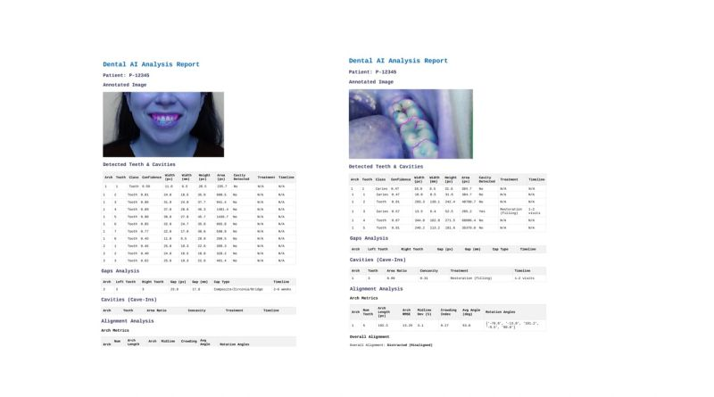
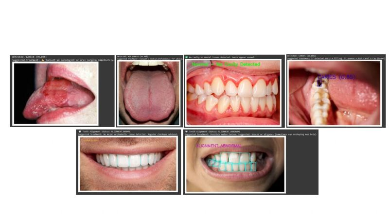

# SmileAlign AI 

**AI-powered dental pre-screening using smartphone images**

SmileAlign AI is a prototype that analyzes uploaded dental images using a Roboflow-hosted computer vision model. It identifies detected tooth regions, estimates gaps between adjacent detections, visualizes the results, and generates a simple rule-based screening suggestion.

> **Disclaimer:** SmileAlign AI is an experimental pre-screening prototype, not a medical or dental diagnostic tool. Its automated suggestions are not clinically validated and must not replace examination or advice from a qualified dentist.

## ✨ Features

- **Tooth detection/segmentation:** Uses a hosted Roboflow model to identify tooth regions in an image.
- **Visual annotations:** Displays detected regions, labels, and estimated gaps over the input image.
- **Gap measurement:** Calculates distances between neighboring detected regions in pixels.
- **Basic alignment heuristic:** Applies a simple threshold-based rule to estimate whether further dental assessment may be useful.
- **Analysis reports:** Prints detected-tooth counts, gap summaries, and a rule-based suggestion.
- **CSV export:** Some notebook workflows save per-tooth and gap measurements as CSV files.
- **Optional calibration:** The code includes an optional pixel-to-millimeter calibration setting; meaningful physical measurements require a suitable reference and validation.

## 🖼️ Project Outputs

### 1. Dental AI Analysis Report

The report view presents an annotated dental image alongside tables for detected teeth and cavities, gap analysis, and alignment analysis.



### 2. Detection and Annotation Examples

These examples show model annotations on different oral and dental images, including tooth regions, cavity labels, and alignment-related labels where detected by the model.



> These images illustrate prototype outputs only. They do not establish diagnostic accuracy or confirm that a particular treatment is needed.

## 🧰 Tech Stack

- Python
- Roboflow hosted computer vision inference
- OpenCV
- NumPy
- Matplotlib
- Pandas
- Shapely
- scikit-learn (including K-Means clustering)
- Google Colab (for the notebook-style upload workflow)

## 🏗️ How It Works

1. The user uploads a dental image.
2. The application sends the image to a configured Roboflow model.
3. The model returns detections, such as bounding boxes and, when available, segmentation polygon points.
4. The code sorts detections and estimates gaps between neighboring detected regions.
5. OpenCV and Matplotlib visualize the annotated image.
6. A simple threshold-based heuristic produces a screening suggestion.
7. Where enabled, the workflow exports tooth and gap metrics to CSV files.

## 📋 Requirements

- Python 3.9+ is recommended; verify compatibility with the installed Roboflow SDK and dependencies.
- A Roboflow account and access to the configured project/model.
- A Roboflow API key.
- Google Colab if you want to use the existing `google.colab.files.upload()` workflow directly.

## 🚀 Getting Started

### 1. Clone the repository

```bash
git clone https://github.com/YOUR-USERNAME/YOUR-REPOSITORY.git
cd YOUR-REPOSITORY
```

Replace the URL with your actual GitHub repository URL.

### 2. Install dependencies

In Google Colab, run:

```python
!pip install roboflow opencv-python matplotlib numpy pandas shapely scikit-learn
```

For a local Python environment, install the packages in your terminal:

```bash
python -m pip install roboflow opencv-python matplotlib numpy pandas shapely scikit-learn
```

### 3. Configure Roboflow credentials

Set your API key using an environment variable or Colab secret. Do not commit API keys to GitHub.

```python
import os
from roboflow import Roboflow

api_key = os.environ["ROBOFLOW_API_KEY"]
rf = Roboflow(api_key=api_key)

project = rf.workspace("ranjita-infb1").project("cavity-detection-pe9t4")
model = project.version(1).model
```

Set the environment variable before running the notebook. For example, in a local terminal:

**PowerShell**
```powershell
$env:ROBOFLOW_API_KEY="your_api_key_here"
python your_script.py
```

In Google Colab, you can store the key in **Secrets** and read it securely, or set it for the current session without saving it in the notebook.

### 4. Run the notebook

The uploaded source file is notebook-style Python exported from Google Colab and contains Colab-specific commands such as `!pip install` and `files.upload()`. The easiest way to run the existing workflow is to open it in Google Colab and execute the required cells in order.

Upload a clear, well-lit dental image when prompted. The notebook should display the annotated output and any reports produced by the cell you run.

## ⚙️ Configuration

The source code includes settings similar to these. Exact names may differ between notebook sections:

| Setting | Purpose |
|---|---|
| `CONFIDENCE` | Model confidence threshold |
| `MIN_BOX_WH` | Filters detections that are too small |
| `GAP_ALERT_PX` | Pixel threshold used to flag a large gap |
| `ALIGN_ALERT_PX` | Threshold used by a basic alignment heuristic |
| `WORKSPACE` | Roboflow workspace identifier |
| `PROJECT` | Roboflow project identifier |
| `VERSION` | Model version |

These thresholds are experimental and image-resolution dependent. They must not be interpreted as clinical standards.

## 📊 Output

Depending on the notebook section executed, the workflow may produce:

- An annotated image showing detected tooth regions.
- Estimated gaps between neighboring detections in pixels.
- A summary of detection and gap measurements.
- A rule-based screening suggestion.
- CSV files such as `teeth_metrics.csv` and `teeth_gap_metrics.csv` in the relevant workflow.

**Important:** Pixel measurements are not physical measurements. Converting pixels to millimeters requires reliable image calibration. Results can be affected by camera angle, perspective, lighting, image resolution, overlapping detections, and model errors.

## 📁 Suggested Repository Structure

```text
SmileAlign-AI/
├── README.md
├── smilealign_site_.py
├── requirements.txt
├── .gitignore
└── assets/
    └── output.png
```

Only add `assets/output.png` if you have a image you are allowed to share. Do not upload identifiable patient images or private health information without appropriate permission and safeguards.

Example `requirements.txt`:

```text
roboflow
opencv-python
matplotlib
numpy
pandas
shapely
scikit-learn
```

The current source is notebook-oriented. For a production repository, consider separating reusable analysis logic from Colab upload/display code and adding a clear application entry point.

## 🔐 Security and Privacy

- Never commit API keys, passwords, access tokens, or `.env` files.
- If an API key has already been committed or shared publicly, revoke or rotate it in Roboflow and remove it from the repository history where appropriate.
- Use environment variables or a secrets manager for credentials.
- Dental photographs may contain sensitive health information. Obtain appropriate consent, minimize data collection, and review the image/model provider's data-handling terms before uploading images.
- Do not publish patient images or results that could identify a person without explicit authorization.

## ⚠️ Limitations
- Tooth count, gap thresholds, and alignment heuristics can fail on partial, rotated, blurred, or poorly lit images.
- The source file contains multiple experimental notebook sections. Run the intended section carefully; not every section is a single integrated application.
- Clinical use would require appropriate datasets, independent testing, calibration, bias and error evaluation, privacy safeguards, and assessment by qualified dental professionals.

## 🛣️ Future Improvements

- Build a clean web interface for image upload and result review.
- Refactor the notebook into reusable Python modules.
- Add robust error handling and input validation.
- Validate detection and segmentation performance on representative test images.
- Improve calibration and perspective correction for measurement research.
- Add clear confidence indicators and explainable results.
- Conduct expert-led validation before considering any clinical application.

## 🤝 Contributing

Contributions and suggestions are welcome. Open an issue to discuss a bug or proposed improvement, or submit a pull request with a clear description of the changes.

## 📄 License

Choose a license before distributing this repository. If you use a Roboflow model or dataset, also review its license and terms. Do not imply that third-party model weights or datasets are yours to redistribute.

## 👥 Acknowledgment

Built as an exploratory AI project using computer vision and a Roboflow-hosted dental image model.

---

**SmileAlign AI supporting early dental awareness through computer vision, with professional dental care remaining essential.**
